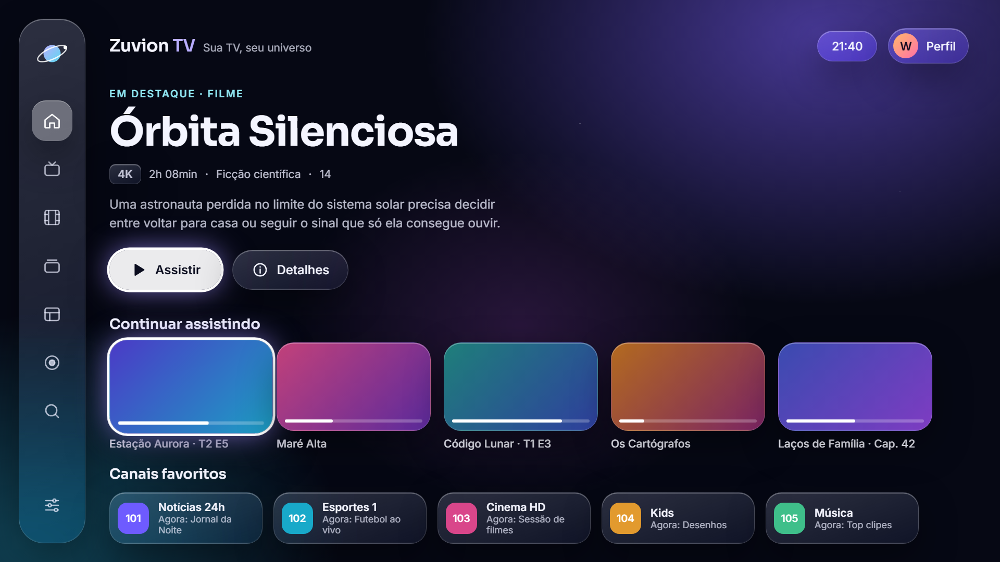
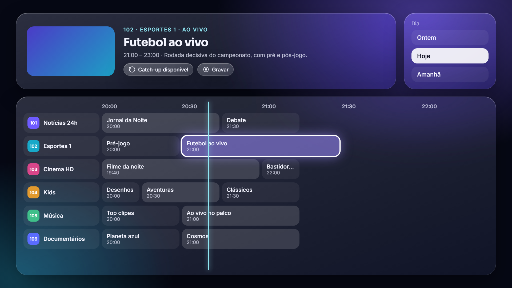
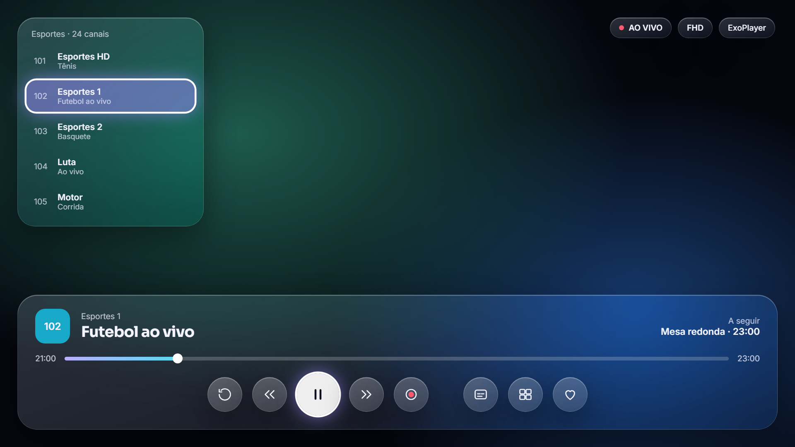
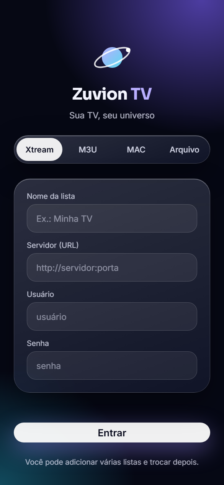
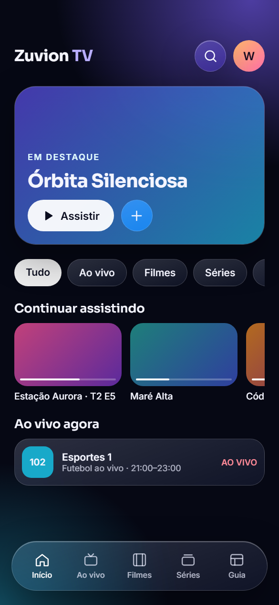
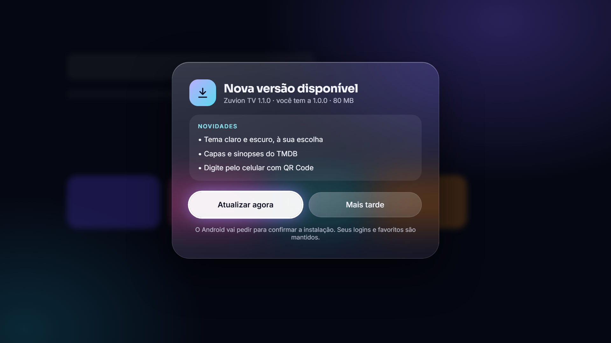
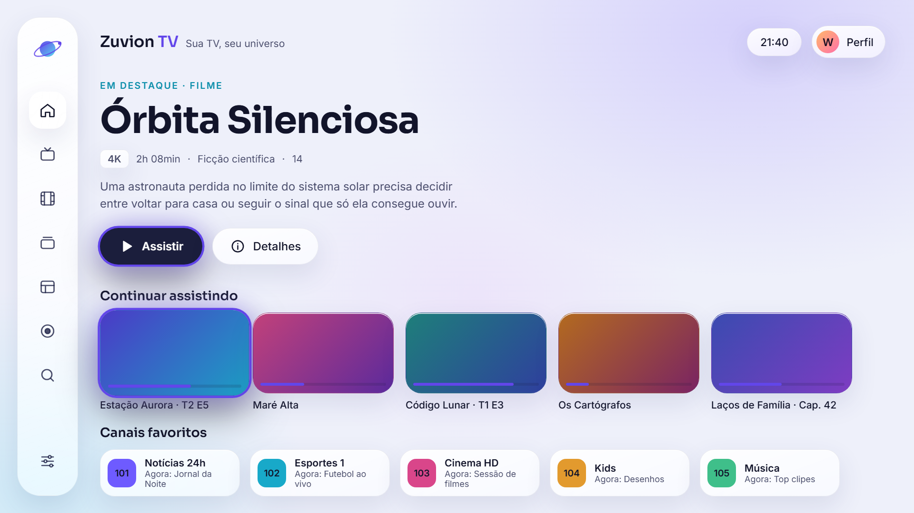
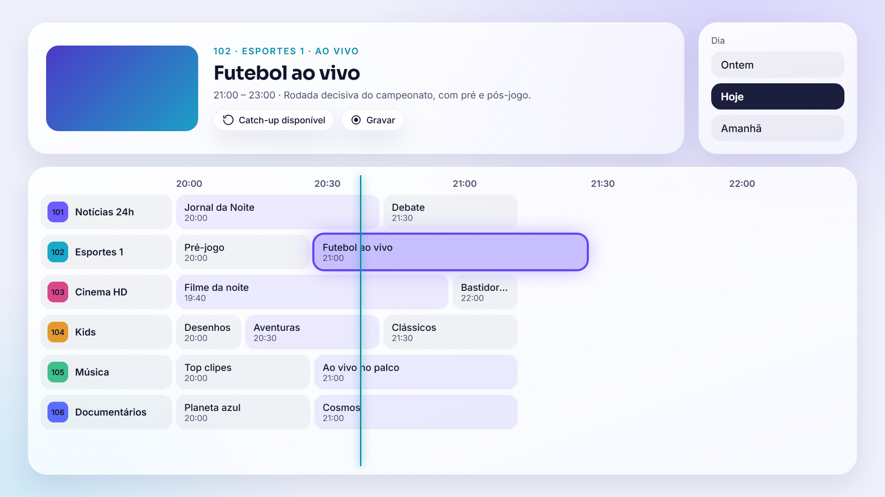
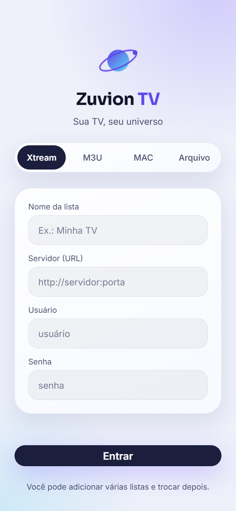
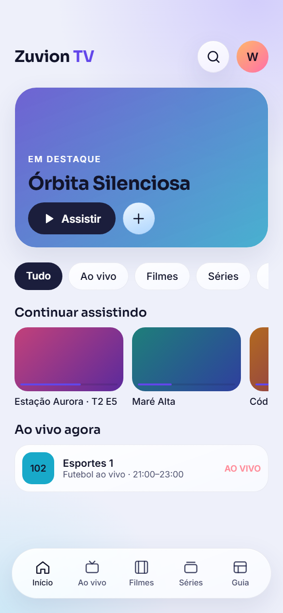

<p align="center">
  
</p>

<h1 align="center">Zuvion TV</h1>
<p align="center"><b>Sua TV, seu universo.</b><br>
Player IPTV gratuito para <b>celular</b> e <b>Android TV / Google TV</b>, com visual de vidro líquido.</p>

<p align="center">
  <a href="https://github.com/waarreno/zuvion-tv/releases/latest"><b>⬇ Baixar a versão mais recente</b></a>
</p>

> O Zuvion TV é só um player: **não fornece canais, filmes nem listas**. Para assistir, use uma lista IPTV contratada com o seu provedor.

## Telas

| TV · Guia de programação | TV · Player |
|---|---|
|  |  |

| Celular · Entrar | Celular · Início | TV · Aviso de atualização |
|---|---|---|
|  |  |  |

### Modo claro

| TV · Início | TV · Guia de programação |
|---|---|
|  |  |

| Celular · Entrar | Celular · Início |
|---|---|
|  |  |

*Imagens do protótipo de design, com conteúdo de exemplo. O tema é escolhido em Configurações → Aparência (automático, escuro ou claro).*

## O que ele faz

- **Funciona com a sua lista:** Xtream Codes, link M3U/M3U8, arquivo M3U do aparelho e portal MAC (Stalker).
- **TV ao vivo, filmes e séries:** categorias, busca, favoritos e "continuar assistindo".
- **Guia de programação (EPG)** em grade, com **replay** (assistir do início) quando o provedor oferece.
- **Capas e sinopses do TMDB**, já configuradas, e notas do IMDb e do Rotten Tomatoes pelo OMDb (com sua chave gratuita).
- **Pular abertura** em séries e filmes, pelo TheIntroDB.
- **Perfis** com nome, avatar e cor, perfil infantil e **PIN** para conteúdo adulto.
- **Multi-tela:** até 4 canais ao mesmo tempo.
- **Gravação** do programa ao vivo.
- **Tema claro ou escuro.**
- **Digitar pelo celular:** na TV, um QR Code abre uma página no celular para digitar o login ou a busca, sem usar o controle.
- **Um canal, vários formatos:** canais e filmes em SD, HD, Full HD e 4K aparecem uma vez só; o formato é escolhido no player e o app lembra a sua escolha.
- **Abre rápido:** a lista fica salva no aparelho e é atualizada a cada 24 horas, ou quando você quiser.
- **Atualizações automáticas:** o app avisa quando sai uma versão nova e só instala com a sua confirmação.

## Como instalar

### No celular

1. Abra a página de [versões](https://github.com/waarreno/zuvion-tv/releases/latest) no celular e baixe o arquivo **`ZuvionTV-…-universal.apk`**.
2. Toque no arquivo baixado. Se o Android pedir, permita **instalar apps desta fonte**.

### Na Android TV / Google TV

1. Na TV, instale o app **Downloader** (by AFTVnews) pela Play Store.
2. No Downloader, digite o endereço abaixo e baixe o APK universal:
   `github.com/waarreno/zuvion-tv/releases/latest`
3. Quando pedir, permita que o Downloader instale apps e confirme a instalação.

Se preferir, copie o APK para um pendrive e abra-o com um gerenciador de arquivos na TV.

O mesmo APK funciona em celulares, tablets, TV boxes e Google TV com processador ARM (32 ou 64 bits, ou seja, praticamente todos), de Android 5.0 em diante. Para instalar, deixe pelo menos uns 600 MB livres na TV: o Android reserva parte do armazenamento e recusa a instalação com "App não instalado" quando falta espaço.

## Primeiros passos

1. Escolha o tipo da sua lista (Xtream, M3U, MAC ou Arquivo) e preencha os dados que o seu provedor enviou.
   Na TV, escaneie o QR Code da tela de login com o celular e preencha tudo por lá.
2. Na primeira vez, o app mostra o carregamento de **TV ao vivo, Filmes, Séries e Guia**. Depois disso, ele abre direto.
3. Para atualizar a lista quando quiser, use o botão **↻** na tela inicial ou **Configurações → Atualizar lista agora**.

### Capas e sinopses

O app já vem pronto para buscar capas e sinopses (TMDB) e pular aberturas (TheIntroDB). As notas do IMDb e do Rotten Tomatoes vêm do OMDb, que limita as consultas por dia; para ativá-las, crie sua chave gratuita e coloque em **Configurações → Capas e sinopses**. Você também pode usar suas próprias chaves do TMDB e do TheIntroDB:

| Serviço | Para que serve | Onde conseguir |
|---|---|---|
| **TMDB** | Capas, fundos, sinopses em português, elenco e nomes dos episódios | [themoviedb.org](https://www.themoviedb.org/settings/api), em Configurações → API |
| **OMDb** | Notas do IMDb e do Rotten Tomatoes | [omdbapi.com](https://www.omdbapi.com/apikey.aspx) |
| **TheIntroDB** | Botão "Pular abertura". Funciona sem chave | [theintrodb.org](https://theintrodb.org) |


## Controle remoto (TV)

| Tecla | No player |
|---|---|
| ▲ / ▼ ou CH+ / CH− | Troca de canal |
| ◀ | Lista de canais (ao vivo) / volta 10 s (filmes e séries) |
| ▶ | Avança 10 s (filmes e séries) |
| OK | Mostra os controles · pula a abertura quando o botão aparece |
| Segurar OK numa lista | Adiciona ou remove dos favoritos |
| Segurar OK em "Continuar assistindo" | Remove da lista e zera o progresso |

## Dúvidas comuns

**Um canal não abre.** Toque no botão de trocar o motor de vídeo (ExoPlayer ↔ VLC) no player. Em **Configurações → Player** você também pode trocar o formato dos canais entre MPEG-TS e HLS.

**O guia está vazio ou incompleto.** Nem todo provedor envia o guia. Em **Configurações → Guia de programação**, ligue o **guia aberto do Brasil** (grade completa de cerca de 260 canais). Em **Listas IPTV → EPG** você também pode informar uma URL XMLTV própria.

**A lista não mudou depois que o provedor adicionou canais.** Use **Atualizar lista agora**.

## Apoie o projeto

O Zuvion TV é gratuito e sem anúncios. Se ele faz parte da sua rotina, considere apoiar com uma doação via **Pix**, de qualquer valor:

<p></p>

**Chave Pix (aleatória):** `ac6ffef1-a34a-4877-be9d-83cc7ee355d4`
Recebedor: Wárreno Hendrick

O QR Code também aparece no app, em **Configurações → Sobre e apoio**.

## Privacidade

O Zuvion TV não tem servidor próprio e não coleta dados. Seus logins ficam só no aparelho. O app se conecta apenas ao seu provedor IPTV, ao GitHub (para verificar atualizações) e, se você configurar, ao TMDB, OMDb e TheIntroDB. A página de digitar pelo celular funciona só na sua rede Wi-Fi e fica ativa apenas enquanto o QR Code está na tela.

## Para desenvolvedores

Feito em Kotlin com Jetpack Compose, Media3 ExoPlayer, libVLC, OkHttp, Coil e kotlinx.serialization.

```bash
gradle :app:assembleDebug
```

Requer JDK 17 e Android SDK 35. Cada tag `vX.Y.Z` gera um Release assinado pelo GitHub Actions, com as notas de `release-notes/X.Y.Z.md`.

© 2026 Wárreno Hendrick. Todos os direitos reservados.

Fontes Inter e Sora sob a SIL Open Font License. Metadados fornecidos pelo TMDB; este produto usa a API do TMDB, mas não é endossado nem certificado pelo TMDB.
